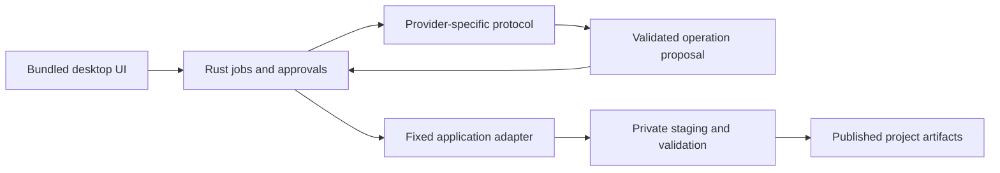

# Hazlo Mexa implementation readiness research

Evidence date: October 10, 2026, America/Los_Angeles.

The recommended starting point remains a Windows 11 x64 Tauri application with Rust controlling one FreeCAD workflow and Ollama proposing dimensions. The deeper inspection changes how we should implement permissions, streaming, artifact acceptance, and recovery. Settle the executable behavior through the [implementation gates](../implementation-gates.md) before building the full interface. Research reduces avoidable rewrites; it cannot establish runtime behavior without execution.

This document refines the earlier reconstructed plan. Its decisions are recommendations, not completed acceptance checks. No engineering application, installer, model inference, firmware, or upstream source build was run. The website remains the only implemented product surface.

## Evidence and reproducibility

The [evidence manifest](source-evidence.json) captures seven release references, their resolved commit IDs, fingerprints for 15 source files, 12 documentation fingerprints, and selected Windows release metadata. Hashes of fetched source bytes make later source drift detectable; hashes reported by GitHub for binary assets are not independent binary verification. Additional official documentation linked below was read in the browser. This is targeted inspection, not a complete audit of those repositories.

| Project | Observed release | Resolved commit |
|---|---|---|
| FreeCAD | 1.1.4 | `4fd3bf320d9566a27e60069fc8387448aaa3a094` |
| CADPilot, LBurny | v0.7.7 | `58bfee4d45061e55c158a5fd4786ab98a427f7f6` |
| CADCraft, storytold | v0.5.0 | `315751e3ec98e708bcc831dd7f80ca0433a2e3d0` |
| Arduino Agent, mixelpixx | v0.7.1 | `fea5bb6a28d689a2ddbd1c635e2e187703c22549` |
| Konnect, mixelpixx | v0.13.0 | `6bbe3e4f890ba1d37c0e5d5f38ccd03d90958c9e` |
| Ollama | v0.40.2 | `b061384d90ff455462bc32745dd0de479de717a3` |
| OrcaSlicer | v2.4.2 | `8500fcdccaa10b5099ac20d252af3a7c560046f1` |

These are investigation candidates, not a certified support matrix. Pin the actual packages and their measured contracts when a gate passes. Do not implement against an unversioned README or assume the release filename proves its contents.

## Findings that change the implementation

| Finding | Evidence | Required design response |
|---|---|---|
| Registered Tauri application commands are available to all app windows by default. | [Tauri capabilities](https://v2.tauri.app/security/capabilities/) documents explicit `AppManifest::commands` configuration. | Restrict application commands explicitly; keep project and approval validation inside Rust. |
| Tauri channels provide ordered streaming; ordinary events lack fine-grained capability control. | [Frontend communication](https://v2.tauri.app/develop/calling-frontend/). | Use a per-job channel for output and a backend snapshot for recovery. A channel is delivery, not persistent state. |
| FreeCAD tries importing `.py` files before a direct-script fallback, and logs some processing errors rather than propagating them. | [Pinned application source](https://github.com/FreeCAD/FreeCAD/blob/4fd3bf320d9566a27e60069fc8387448aaa3a094/src/App/Application.cpp). | Avoid a bootstrap whose work runs only under `__main__`; require a fresh structured result and valid artifacts as well as an acceptable process exit. |
| Ollama can emit an error after an HTTP 200 streaming response has begun. | [Ollama errors](https://docs.ollama.com/api/errors). | Parse error records throughout the stream. EOF and HTTP 200 do not mean success. |
| Ollama local structured output and Ollama Cloud have different support. | [Structured outputs](https://docs.ollama.com/capabilities/structured-outputs) currently excludes Cloud. | Keep local and cloud profiles distinct; no automatic cloud fallback. |
| CADCraft's Windows package source includes its CLI. | [Pinned package script](https://github.com/storytold/cadcraft/blob/315751e3ec98e708bcc831dd7f80ca0433a2e3d0/packaging/windows/package.ps1). | Check the official portable package before planning a source build. Signing is optional in the build script, so verify the actual package. |
| CADCraft's inspected control server accepts loopback JSON requests without an authentication check in that handler. | [Control server](https://github.com/storytold/cadcraft/blob/315751e3ec98e708bcc831dd7f80ca0433a2e3d0/apps/cadcraft/src/control_server.rs). | A gateway cannot alone protect an underlying locally reachable port; gate GUI mutation support separately. |
| CADPilot exposes Python execution through an IP-filtered XML-RPC server. | [RPC server](https://github.com/LBurny/cadpilot/blob/58bfee4d45061e55c158a5fd4786ab98a427f7f6/addon/CADPilot/rpc_server/rpc_server.py), [IP filtering](https://github.com/LBurny/cadpilot/blob/58bfee4d45061e55c158a5fd4786ab98a427f7f6/addon/CADPilot/rpc_server/ip_filter.py). | Do not describe it as project-isolated. Reuse its modeling tools later after constraining the actual execution boundary. |
| CADPilot already distinguishes recoverable read calls from uncertain writes. | [FreeCAD client](https://github.com/LBurny/cadpilot/blob/58bfee4d45061e55c158a5fd4786ab98a427f7f6/src/cadpilot/freecad_client.py). | Preserve its no-blind-write-retry behavior rather than adding a general retry wrapper. |
| Arduino Agent's bridge retries once after a stale-session 401/404. | [Bridge source](https://github.com/mixelpixx/Arduino-Agent/blob/fea5bb6a28d689a2ddbd1c635e2e187703c22549/arduino-mcp-extension/bridge/arduino-agent-bridge.js). | Verify that these responses precede side effects before allowing write/upload operations. This is a test requirement, not a finding that duplicate writes actually occur. |
| Konnect's inspected dispatcher uses the legacy initialize lifecycle and changes its active tool catalog. | [Handler](https://github.com/mixelpixx/Konnect/blob/6bbe3e4f890ba1d37c0e5d5f38ccd03d90958c9e/crates/konnect-core/src/mcp/handler.rs). | Support the server's actual negotiated protocol and tool-list changes, rather than coding only the newest MCP flow. |

## Architecture decisions to establish now

These choices give later adapters room to change without making every screen understand every upstream protocol.

| Boundary | Recommended baseline | Reason to revisit |
|---|---|---|
| Product host | Tauri 2, one Rust application crate, Windows MSVC x64 | A measured native compatibility failure, not speculation about other platforms |
| Frontend | Bundled TypeScript and Vite, npm lockfile, a few accessible screens | Introduce a framework only when real UI work justifies it; Rust commands and job data stay the same |
| Local AI | Native Ollama REST; select a model only after local quality and latency checks | A failed benchmark can change the model or provider without changing the geometry operation |
| Remote AI | Claude Messages API and a concrete OpenAI endpoint as independent adapters | A harness is useful only when its built-in tools and permissions pass separate checks |
| Codex | Owned `app-server` stdio process with version-specific schemas | Avoid the experimental dynamic-tools route as an obligatory foundation |
| First CAD operation | App-owned fixed FreeCAD macro/script and validated JSON input | Add CADPilot for interactive modeling only after its execution boundary passes |
| MCP | Add the official Rust SDK when an integration needs MCP | No custom protocol stack or persistent gateway on day one |
| Project state | Versioned project manifest, per-run snapshot, staging and published output directories | SQLite when querying or concurrent writers actually require it |
| Installation | Detect and guide manual provisioning first | Automation only after package identity, scope, and recovery tests pass |
| Distribution | Per-user NSIS package; explicit WebView2 strategy; early clean-machine test | MSI if a real deployment requirement calls for it |

Tauri documents Vite/static frontend integration and MSVC/WebView2 prerequisites. Node is a build tool for this baseline, not a runtime shipped with every installation. [Vite configuration](https://v2.tauri.app/start/frontend/vite/), [prerequisites](https://v2.tauri.app/start/prerequisites/).

Use `serde`/`serde_json` for typed data, Tauri's existing async runtime plus Tokio process/network primitives, `reqwest` for HTTP, and Windows APIs for process ownership and credential storage as needed. Choose exact dependency versions through a compiling spike and commit lockfiles; add no provider SDK runtime simply to wrap an HTTP call. This is a dependency shortlist, not a tested Cargo manifest.

Keep networking, secrets, filesystem mutation, approvals, and process dispatch in Rust. The frontend sends typed requests and displays results. Provider-specific events are decoded privately; only validated product data crosses to the UI. This does not require a generic plugin system or a universal conversation representation.



The first complete path uses one operation. Future application integrations receive their own typed operations and acceptance checks, rather than an all-purpose `execute(command, arguments)` interface.

## Provider contracts and AI behavior

### First operation

The initial feature creates a **rectangular solid**, not a hollow electronics enclosure. This distinction must be visible in the UI and prompt examples. A hollow enclosure needs additional geometry and constraints and is a later recipe.

Accept three explicit dimensions in millimetres. Provider output is a proposal only. Validate finite numeric values, the agreed 1–200 mm range, required fields, and absence of unknown fields before approval. Missing or ambiguous dimensions produce clarification; do not fill them with invisible defaults. A returned schema can be well formed yet describe the wrong dimensions.

Keep deterministic manual dimension entry available through the same operation. This separates CAD correctness from model quality and gives users a usable path when local inference is unavailable. Model choice and instructions must not alter the meaning of a stored operation.

For version 1, a provider adapter needs text/status output, one completed dimension proposal, a terminal result, and cancellation. Do not implement an unrestricted agent loop, tool router, memory service, embeddings, fine-tuning, or RAG to create a solid. The architecture must allow later operations, but the first provider does not need their contracts implemented.

### Wire behavior

| Provider route | Protocol handling | Success condition | Cancellation scope |
|---|---|---|---|
| Ollama local | `/api/chat`, NDJSON records, schema in `format` | Terminal completion, no stream error, complete host-validated proposal | Abort request; prevent all subsequent dispatch; measure local inference stop separately |
| Claude Messages | SSE events, indexed content blocks, accumulated JSON argument deltas | Complete message and valid proposal; distinguish tool-use and token-limit stops | Abort transport; no assumption of refund or instantaneous server stop |
| OpenAI Responses | Native response/item events and function-call IDs | Completed response and validated proposal; handle refusal/incomplete states | Cancel only where the selected API mode supports it; dropping a stream is weaker |
| Codex app-server | Bidirectional requests/notifications over stdio | Version-specific completed turn; pending server requests resolved | `turn/interrupt`, then terminal turn status; owned-process cleanup is separate |

Sources: [Ollama chat](https://docs.ollama.com/api/chat), [Claude streaming](https://platform.claude.com/docs/en/build-with-claude/streaming), [OpenAI structured output](https://developers.openai.com/api/docs/guides/structured-outputs), [OpenAI function calls](https://developers.openai.com/api/docs/guides/function-calling), [OpenAI background cancellation](https://developers.openai.com/api/docs/guides/background), [Codex app-server](https://learn.chatgpt.com/docs/app-server).

Transport chunks are not protocol records. The eventual parser must retain incomplete UTF-8 and records between reads; it must bound buffers and handle several records in one read. Only a complete successful proposal can reach approval. No partial streamed object may trigger a CAD operation. Preserve tool IDs and opaque provider continuation data within that adapter when needed; converting everything to plain text loses important protocol state.

For local-only Ollama, use an explicit loopback endpoint, disable redirect following and system proxies for that client, and reject cloud model routing for the offline profile. A localhost API can still forward work to a cloud model. Remote endpoints need a separate approved HTTPS profile, host-bound credentials, and a preview of data to be transmitted. Reqwest normally follows redirects and has proxy controls, so defaults require deliberate configuration. [Reqwest client configuration](https://docs.rs/reqwest/latest/reqwest/struct.ClientBuilder.html).

Ollama's inspected chat path derives an inference context from the HTTP request context and passes it to completion. That supports aborting the request, but does not prove a five-second stop on this hardware or release. Do not kill a shared Ollama service to satisfy cancellation. [Pinned routes](https://github.com/ollama/ollama/blob/b061384d90ff455462bc32745dd0de479de717a3/server/routes.go).

### Harness and authentication boundaries

Codex provides schema generation tied to the installed CLI version and an experimental dynamic-tool interface. Pin both protocol and process; do not couple the UI to the whole RPC schema. Use documented authentication, and keep Hazlo Mexa's configuration separate from the user's global Codex settings. Command approvals and engineering-operation approvals are different boundaries. [App-server](https://learn.chatgpt.com/docs/app-server), [authentication](https://learn.chatgpt.com/docs/auth).

The current Claude Agent SDK permission order evaluates hooks and rules before its fallback callback. `allowedTools` can pre-approve a matching tool; it should not be treated alone as an exclusive set or proof that every call reaches a host callback. If we later use the SDK, verify tool removal and denial with negative tests. Its native runtime is additional packaging and policy work, which the Messages API path avoids initially. [SDK permissions](https://code.claude.com/docs/en/agent-sdk/permissions), [SDK overview and authentication constraints](https://code.claude.com/docs/en/agent-sdk/overview).

API credentials, Codex sign-in, and vendor subscriptions remain separate access models. The documented open-source Sign in with ChatGPT route has preview limitations; its availability for a user/model must be verified, not inferred from a model catalog. Do not read another application's cookie or token storage. [Sign-in preview limitations](https://developers.openai.com/siwc/token-sharing-open-source/preview-limitations).

## FreeCAD execution and artifact acceptance

FreeCAD maintainers describe scripts run through `FreeCADcmd.exe` as the headless interface. Its headless environment does not supply normal GUI documents/view providers. Generate geometry without GUI modules; open the accepted artifact in the GUI as a separate user action. [Maintainer discussion](https://github.com/FreeCAD/FreeCAD/discussions/32183), [headless documentation](https://github.com/FreeCAD/FreeCAD-documentation/blob/main/wiki/Headless_FreeCAD.md).

Use FreeCAD's embedded runtime rather than importing its modules from the system Python. The first editable output should use native `Part::Box` properties, with an FCStd master and a STEP derivative. FreeCAD's box implementation exposes Length, Width, and Height; a static shape export alone would lose that native parameter editing. [Box implementation](https://github.com/FreeCAD/FreeCAD/blob/4fd3bf320d9566a27e60069fc8387448aaa3a094/src/Mod/Part/App/FeaturePartBox.cpp).

The execution proof must determine the exact bootstrap extension, argument handling, termination, and error reporting. An app-owned `.FCMacro` is a candidate because it takes the direct execution route; a `.py` bootstrap needs to account for import-first behavior. The proposed JSON handoff uses a fixed filename in the owned working directory, avoiding generated Python interpolation and assumptions about FreeCAD's handling of arbitrary extra arguments. None of these choices is certified until tested.

Generate a new document in a new run directory. The adapter writes a result record containing the job identity, success/failure, geometry measurements, application version, and output references. Rust verifies the record belongs to this run and the outputs are new, regular files in staging. Stdout is diagnostics, not the authoritative result channel.

Acceptance should check exactly one non-null valid solid, expected extents, and volume; then reopen FCStd and separately import STEP to compare geometry. A syntactically valid file or a process exit code cannot substitute for these checks. Fail closed on missing result, unexpected files, script exceptions, timeouts, invalid geometry, or inconsistent outputs. The probe must confirm error propagation; it must not assume that every logged error causes a nonzero exit. [Command entry point](https://github.com/FreeCAD/FreeCAD/blob/4fd3bf320d9566a27e60069fc8387448aaa3a094/src/Main/MainCmd.cpp).

Use the selected official portable package for the isolated test when provisioned. Establish how configuration, Python/module paths, and installed addons are loaded; launching from a separate working directory is insufficient. Avoid inheriting untrusted `PYTHONPATH`, user macros, and addon code. A bounded adapter still executes native code; importing untrusted third-party CAD files is a different capability requiring separate assessment.

## Projects, approvals, cancellation, and recovery

Use one backend authority for the active job and its current project. UI closure, refresh, or lost streaming listeners must not accidentally approve, repeat, or abandon a running effect. A later UI reads a current snapshot. Stream messages carry a job ID and monotonic sequence so stale output cannot update a new job.

An approval binds the validated operation, dimensions, project identity, destination, and adapter version. Consume it once. Editing dimensions, changing the selected project, selecting a different executable, or restarting after a crash invalidates it. The UI sends an approval ID; it does not send replacement arguments with the approval response.

| State or transition | Required behavior |
|---|---|
| Proposing → awaiting approval | Completed, validated data only; no application dispatch |
| Awaiting approval → running | Recheck binding and project; consume approval once |
| Cancel before dispatch | Mark cancelled; no child and no published artifact |
| Cancel during CAD staging | Stop owned job; keep partial data private; no publication |
| Validation → publication | Serialize cancellation and commit decision; recheck the active job |
| Cancel after publication | Retain successful artifacts and report that publication already completed |
| Lost response after a possible write | Record uncertain effects and inspect state; never automatically repeat |
| Restart with an incomplete run | Preserve inputs and staging; require inspection or a fresh approved run |

Windows Job Objects can group and terminate owned processes. Create and associate an owned child before it can spawn descendants where practical; verify nested-job behavior and always reap the child. Tokio does not kill a child on handle drop by default, and direct-child termination does not establish descendant cleanup. Job Objects govern lifecycle/resources, not filesystem isolation. [Microsoft Job Objects](https://learn.microsoft.com/en-us/windows/win32/procthread/job-objects), [Tokio process behavior](https://docs.rs/tokio/latest/tokio/process/struct.Command.html).

Keep one writer per project for the alpha. Use a versioned manifest and complete run snapshots as authority; JSONL logs are diagnostics rather than the sole recovery mechanism. Write snapshots through a temporary file and an appropriate replace operation. Unknown future format versions fail without rewriting the file; migrate only a saved copy after a documented conversion exists.

Treat an artifact set as one published directory. Stage on the same volume, validate the whole set, then commit through a tested directory publication operation; reserve destinations and prohibit replacement of existing artifacts. Publishing FCStd and STEP as independent final files can leave a half-published result. A crash between publication and the final status update needs reconciliation against the published run identity. Rename is not a multi-file transaction or a universal power-loss guarantee. [Rust rename behavior](https://doc.rust-lang.org/std/fs/fn.rename.html).

Accept filesystem locations through explicit project selection, not model output. Validate Windows paths at the write/open boundary: traversal, junction/reparse escape, device/reserved names, alternate data streams, UNC paths, and case behavior. Canonicalizing a nonexistent destination or comparing a string prefix is insufficient; resolve the parent and verify handles where feasible. The first version should support local NTFS only until network/synced locations have been tested. [Windows path rules](https://learn.microsoft.com/en-us/windows/win32/fileio/naming-a-file), [resolved paths by handle](https://learn.microsoft.com/en-us/windows/win32/api/fileapi/nf-fileapi-getfinalpathnamebyhandlew), [CreateFile semantics](https://learn.microsoft.com/en-us/windows/win32/api/fileapi/nf-fileapi-createfilew).

## Reuse strategy for the engineering applications

| Application | Reuse | Additional Hazlo Mexa work | First enabled scope |
|---|---|---|---|
| FreeCAD | Embedded Python and native document/geometry types | Small fixed adapter, results, geometry validation, process ownership | New rectangular solid, FCStd and STEP |
| CADPilot | Existing modeling tools, GUI coordination, measurement, recovery | Restrict broad execution and document selection; certify chosen addon/runtime pair | Optional read/measurement proof, then approved copy-based edits |
| CADCraft | Official Windows CLI and its existing MCP tools | Verify package, drawing-loss behavior, control-port boundary, timeout state | Inspect/convert copies; live mutation later |
| Arduino CLI | Official JSON CLI, compile and board tooling | Own configuration/cache paths; pin board/core; validate generated sketch layout | Compile only |
| Arduino Agent | Existing bridge and interactive tool catalog | Token lifecycle, routers, launch side effects, retries, hardware identity | Opt-in after CLI workflow |
| KiCad | Official CLI checks/exports; GUI IPC for supported editing | Versioned fixtures, libraries, busy-state handling, result interpretation | ERC/DRC/export on copies |
| Konnect | Existing schematic/PCB tools and tests | Schema/catalog changes, paths, native IPC consistency and recovery | Opt-in after KiCad CLI workflow |
| OrcaSlicer | Stable file formats and release-specific CLI | Machine/process/material profiles, units, output verification | Import/export and later slice-to-file |

Arduino's sketch naming/directory rules must be part of its adapter; a loose `.ino` file is not always a valid sketch. Give Hazlo Mexa explicit data, download, user/library, and build locations rather than silently changing the user's global toolchain. A successful compile does not authorize upload. [Sketch specification](https://docs.arduino.cc/arduino-cli/sketch-specification), [configuration](https://docs.arduino.cc/arduino-cli/configuration), [integration options](https://docs.arduino.cc/arduino-cli/integration-options).

KiCad IPC depends on an open application and its interaction state. CLI export/check support does not establish headless editing parity. For DRC/ERC, consume reports and the documented violation-exit option rather than treating exit zero as design correctness. Konnect uses direct schematic editing and PCB IPC, so the two modes need separate round-trip fixtures. [KiCad IPC](https://dev-docs.kicad.org/en/apis-and-binding/ipc-api/), [KiCad 10 CLI](https://docs.kicad.org/10.0/en/cli/cli.html), [Konnect architecture](https://github.com/mixelpixx/Konnect/blob/6bbe3e4f890ba1d37c0e5d5f38ccd03d90958c9e/README.md).

OrcaSlicer 2.4.2 source contains settings/filament loading and slicing paths. That is stronger evidence than a current wiki listing, but Windows invocation, configuration inheritance, and produced files still need a release-specific proof. Windows x64 and ARM64 assets are listed in release metadata; only x64 belongs in the proposed first matrix. No printer connection or machine control is needed for slice-to-file. [Pinned source](https://github.com/OrcaSlicer/OrcaSlicer/blob/8500fcdccaa10b5099ac20d252af3a7c560046f1/src/OrcaSlicer.cpp), [release](https://github.com/OrcaSlicer/OrcaSlicer/releases/tag/v2.4.2).

The official Rust MCP SDK documents current and legacy protocol support. Prefer a published, pinned SDK release with conformance tests to a handwritten compatibility layer. Its repository documentation does not prove every published crate or engineering server supports every feature. Restrict to needed features and stdio first; test discovery/fallback, catalog changes, errors, cancellation, and unexpected server requests. MCP roots and tool annotations are not filesystem enforcement. [Rust SDK](https://github.com/modelcontextprotocol/rust-sdk), [stdio compatibility](https://modelcontextprotocol.io/specification/2026-07-28/basic/transports/stdio), [tool contract](https://modelcontextprotocol.io/specification/2026-07-28/server/tools).

## Installation, distribution, and local readiness

Use detection and manually provisioned official packages for the first proof. Record exact path/version/architecture and package provenance. A user-selected executable still needs identification. Do not execute repository-supplied setup scripts or install a package merely because a model suggested it.

The source manifest records the FreeCAD Windows portable archive at approximately 418 MB and the Ollama Windows amd64 archive at approximately 1.47 GB, before model downloads. These costs reinforce separate provisioning rather than bundling everything in the desktop installer. These are download metadata sizes, not installed disk requirements.

Ollama's Windows installer installs per-user and its normal app downloads updates automatically. An existing user's service can therefore change independently of Hazlo Mexa. Detect its version/capabilities each connection, certify explicit combinations, and report incompatibility without replacing the user's installation. An owned portable runtime is a later provisioning choice, with separate storage/update costs. [Windows deployment](https://docs.ollama.com/windows), [updates](https://docs.ollama.com/faq).

Tauri supports NSIS and MSI. MSI adds Windows/WiX build requirements; choose NSIS per-user initially and settle identifier, upgrade behavior, and WebView2 download/offline behavior in the early package proof. An offline AI workflow and an offline fresh installation are separate acceptance criteria. Avoid claiming both until tested. Updater signatures and Windows executable signing are separate mechanisms; keep update-key management out of the first prototype. [Windows packaging](https://v2.tauri.app/distribute/windows-installer/), [updater](https://v2.tauri.app/plugin/updater/).

Local read-only observations:

- Windows 11 Pro x64, reported build `10.0.26200`.
- Physical memory: `16,500,436,992` bytes, approximately 15.4 GiB.
- Graphics name: Intel Arc Graphics. The legacy WMI AdapterRAM field is not a reliable measure of available shared/usable inference memory.
- Ollama executable found in its per-user installation. GET requests to `127.0.0.1:11434` were refused; no server version, model list, or inference benchmark was obtained.
- No FreeCAD command found on PATH and no matching FreeCAD entry found in the queried standard HKCU/HKLM uninstall keys. This does not exclude a portable installation elsewhere.
- Rust/Cargo and Node/npm executables exist. A Tauri compile, MSVC prerequisite check, and WebView2 certification remain pending.

Current Ollama documentation describes Vulkan support on Windows; Intel Arc acceleration and model fit on this actual machine remain unverified. Begin the benchmark with a small schema-capable local model and a CPU fallback. Do not assign a model, context length, or performance promise from RAM alone. Record model license, digest, runtime, driver/backend, memory use, cold-start time, and Spanish proposal accuracy. [Hardware support](https://docs.ollama.com/gpu), [model metadata](https://docs.ollama.com/api/tags).

## What can be built after the gates

Build in this order: deterministic geometry operation, backend job/recovery path, Tauri command boundary, provider proposal parser, then the interface and first package. A failed model benchmark should not require rewriting the geometry adapter. A failed upstream live-edit boundary should not require rewriting the project format or approval UI.

Keep the first proposed directory structure small:

```text
apps/desktop/
  src/                       TypeScript interface
  src-tauri/
    src/                     jobs, projects, policy, providers, FreeCAD adapter
    resources/freecad/       app-owned fixed script, added after its proof
    capabilities/            explicit main-window permissions
    permissions/             application command permissions
docs/
  implementation-gates.md
  research/
tests/fixtures/              reviewed inputs and recorded protocol fixtures
website/                     existing public landing page
```

Do not extract provider/application crates before a second working adapter creates a real reuse requirement. Keep persistent file format, UI commands, and operation semantics versioned. Everything else can remain private modules and change during the proofs.

The [gate register](../implementation-gates.md) defines what must be demonstrated before expanding implementation. Freeze each passed boundary with a small regression fixture. Reopen decisions when there is a failing test, required new workflow, or upstream contract change; avoid repeatedly reconsidering settled choices without evidence.

Outstanding work: runtime proofs, selected-model benchmark, real binary/signature/archive verification, complete redistribution review, clean-machine packaging, and physical hardware tests. Broad integrations and the original 24-week estimate remain conditional on those results.
